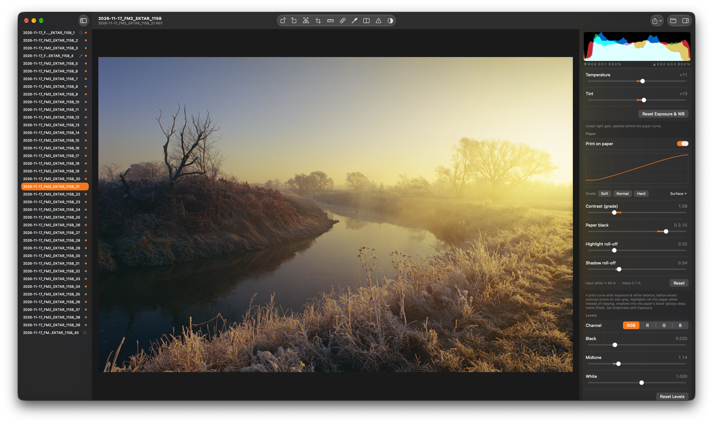

# NegConv

Native macOS app for converting camera-scanned colour negatives (Nikon NEF, Canon CR2/CR3, Fujifilm RAF) into positives — developed on a Nikon D810 / D750. Non-destructive: every edit lives in a JSON sidecar next to the RAW file; roll-wide settings live in `NegConv Roll.json` in the roll folder.

> **A note before you start**
>
> NegConv was vibe-coded together with Claude (Anthropic's AI) and was built for my own film-scanning workflow. You're very welcome to use it, fork it or borrow ideas from it, but please keep in mind that I'm an electrical engineer, not a professional software developer :) It works well for me, but it comes with no warranty. Keep backups of your RAW files and expect the occasional rough edge.



## Install
1. Download the latest `NegConv-<version>-<build>.zip` from [Releases](../../releases) (Apple Silicon + Intel, macOS 14 or newer).
2. Unzip it and drag **NegConv.app** to **Applications**.
3. The app is not signed with an Apple Developer ID, so macOS will block it on first launch ("app is damaged" or "cannot be verified"). Remove the quarantine flag once in Terminal:
   ```bash
   xattr -dr com.apple.quarantine /Applications/NegConv.app
   ```
   Or, without Terminal: try to open the app, then go to **System Settings → Privacy & Security** and click **Open Anyway**.
4. Open NegConv and choose a folder of RAW scans with **⌘O**.

## Documentation
- Spec and status: [`project_doc/NegConv_spec.md`](project_doc/NegConv_spec.md)
- How the conversion maths works (what each slider does): [`project_doc/NegConv_math.md`](project_doc/NegConv_math.md)

## Build & run
- Open `NegConv.xcodeproj` in Xcode 27.2+ and press ⌘R. Requires macOS 14+.
- `Sources/` is a synchronized folder: any `.swift` / `.metal` file placed there is part of the target.
- `xcode-select -p` must point to `/Applications/Xcode.app/Contents/Developer`.

Already configured in the project: Swift 5 mode, default actor isolation `nonisolated`, App Sandbox with user-selected read/write, Metal `-fcikernel` (compiler + linker), ad-hoc signing ("Sign to Run Locally").

### Copy for another Mac
```bash
./build_release.sh          # → dist/NegConv-<version>-<build>.zip (Apple Silicon + Intel)
```
Current version: **0.9** (build 9). On the other Mac: unzip → Applications → first launch: System Settings → Privacy & Security → **Open Anyway** (or `xattr -dr com.apple.quarantine /Applications/NegConv.app`). Bump `MARKETING_VERSION` for new versions.

## Workflow (per roll)
The inspector runs top → bottom in this order.
1. **⌘O** open the roll folder. **G** shows the roll as a contact sheet (grid) in place of the preview, **E** (or double-click / Return on a tile) goes back to editing; arrows move between frames. Unedited frames show the camera's embedded negative, edited ones a small positive that follows your edits. Keep RAW Decode settings fixed for the whole roll (top of the inspector, collapsed). **⌘I** Roll Info: camera, lens, film stock, box ISO / shot-at EI, development, date, location, credits — this (not the scan camera) goes into the exports.
2. Rotate (**⌘[ ⌘]**), flip (**⌥⌘F**), straighten (**⌘L**, draw along a horizon/vertical), crop (**⌘K**, Return to apply) — crop inside the image, excluding rebate and sprocket holes.
3. **⌘B** sample the film base on one frame: drag a box on clear rebate (not on sprocket holes). Then **Use for Whole Roll** — every frame without its own sample uses it.
4. Crop the other frames (paste crop with ⇧⌘V if the holder didn't move), then **Analyse Roll** in the Roll section (~2 s per frame). Exclude blank frames / test shots (**Exclude frame**, or right-click in the list).
   Points: **Roll colour** (default for new frames) = the roll's colour balance, fitted to each frame's range so no channel clips → neighbouring frames match, a sunset stays a sunset. **Frame** = each frame's own percentiles (old behaviour). **Roll** = identical points for the whole roll. Editing a density slider switches to manual.
5. Exposure & white balance: **⌥⌘W** click something neutral, then Exposure.
6. Paper: turn on **Print on paper** for a print look — Grade (Soft/Normal/Hard) sets contrast around mid-grey, highlights roll off instead of clipping, Surface/Paper black sets how deep blacks go (matte = lifted). Brightness stays on Exposure.
7. Levels: per channel, then RGB — trims on the print.
   Curves: RGB / R / G / B. Click to add a point (it lands on the curve), drag to move (hold ⇧ for fine), drag a point off the graph to remove it (red ring) or use −; end points move like levels black/white. In/Out shown 0–255. Histogram of the result behind the graph, other channels' curves shown faintly.
8. Colour mixer: **⌥⌘M** click a colour (e.g. the sky) and shift its hue / saturation / luminance. Works in B&W too (it runs before Presence).
9. Presence: **Vibrance** lifts muted colours (skin protected), **Saturation** scales all colour; both keep brightness (OkLab). Saturation −100 = B&W.
   Sharpen: luminance-only unsharp mask, applied last. **Amount** (0–300 %), **Radius** in full-resolution pixels (≈ 0.6–1 for D810, 0.8–1.2 for D750), **Threshold** (levels; raise it if grain gets gritty). Judge it at 1:1 (tap Z / hold ⌥) — the fitted preview only approximates it.
   Check your work: hold **\** for **before** (the plain inversion — crop, spots, base and points kept; exposure/WB, paper, levels, curves, mixer, presence, sharpening reset). Press **J** for the **clipping overlay**: red = will export as pure white, blue = pure black, magenta = both — tested in the export colour space (Adobe RGB for TIFF, sRGB for JPEG), so out-of-gamut colours show too.
   Match frames: once one frame looks right, pin it as **reference** (**⇧R**, Reference section). On the next frames show it **side by side** (**⌥⌘R**) or hold **R** to flash it in place, and use **Match WB to Reference** (**⇧⌥⌘W**) to copy its colour balance (neutral midtones; exposure untouched).
10. Dust: **⌘J**, click specks; **drag to paint** along hairs/scratches; **⇧-click** draws a straight stroke from the last spot (hold ⌥ for the 100 % loupe, space+drag pans at 1:1).
    Per frame (Shooting Data section, near the bottom): date & time, aperture, shutter (`1/125`, `2s`), lens, focal length, caption — empty fields use the roll info.
11. **⇧⌘C** copy settings → next frame **⇧⌘V** (choose what to paste, or Paste to All Frames).
12. **⌘E** export frame / **⇧⌘E** export roll → `NegConv Export/`. Format and size: **⌥⌘E**.

## Retag exported photos
Scans converted elsewhere (Capture One, Lightroom, older NegConv) carry the *scanning* camera's EXIF. **File → Retag Exported Photos…** rewrites the metadata of a folder of JPEG / TIFF exports so they describe the analog shot instead:
- Rolls are taken from file names `<date>_<camera code>_<film>_<roll#>_<frame#>` (e.g. `2026-10-22_FEa_Portra160_1131_07.jpg`; date and camera code optional). Other files go to "Other files", unticked when the folder has roll frames.
- Each roll is pre-filled: camera code → make/model (remembered once you set it), film code → stock and box ISO (`Portra160` → Kodak Portra 160, ISO 160), roll date from the name, camera code as keyword. Edit the rest (lens, development, location, credits) in the roll panel; per-frame f-stop, shutter, lens, date and caption in the table.
- **All** existing metadata is removed — scan camera, lens, serial, exposure, the XMP and IPTC copies, GPS, captions/copyright left by converter presets, the embedded preview — and replaced by the same analog fields as a NegConv export. The image data is copied unchanged (no re-compression); each file is read back and gets ✓ only if no scanner model/serial/lens text is left and (JPEG) the compressed image is byte-identical.
- Write copies to `Retagged/` (default) or replace the originals (asks first). The edits are kept in `NegConv Retag.json` in the folder.

## Keyboard reference
| Keys | Action |
|---|---|
| ⌘O | Open roll folder |
| G / E | Grid (contact sheet) / loupe — in the grid: arrows move, Return or double-click edits |
| ⌘[ / ⌘] | Rotate left / right |
| ⌥⌘F | Flip horizontal |
| ⌘K, Return | Crop, apply crop |
| ⌘L | Straighten (draw line) |
| ⌘B | Sample film base |
| ⌘\ | Show negative / positive |
| hold \ | Before (plain inversion) |
| J | Clipping overlay on/off (red highlights, blue shadows, magenta both) |
| ⇧R | Pin current frame as reference |
| hold R | Flash the reference in place of this frame |
| ⌥⌘R | Reference side by side |
| ⇧⌥⌘W | Match white balance to reference |
| ⌥⌘W | White-balance picker |
| ⌥⌘M | Colour-mixer picker |
| ⌘J | Spot removal — click = spot, drag = brush stroke, ⇧-click = straight stroke, `[` `]` size, ⌫ delete, Return done |
| Space + drag | Pan the 1:1 view (any tool; in the spot tool plain drag paints) |
| hold Z or ⌥ | Loupe at cursor (⌥ + scroll/pinch or +/− for 100/200/400 %) |
| tap Z, ⌘1, double-click | 1:1 view (drag/scroll to pan, pinch or +/− to zoom, Esc to fit) |
| ⇧⌘C / ⇧⌘V | Copy / paste settings |
| ⌘E / ⇧⌘E / ⌥⌘E | Export frame / roll / export settings |
| ⌘I | Roll Info (shooting data for the whole roll) |
| Esc | Exit current tool |
| ⌘? | Help window (this workflow + keyboard reference, in the app) |
| Sliders | Drag = relative; hold ⇧ = 10× finer (any time, no jump) · click track = jump · double-click slider or title = reset |
| Slider value | Drag the number to scrub (⇧ fine) · click to type (Return / Esc, ↑↓ step, ⇧↑↓ ×10) |
| Inspector edge | Drag to widen the panel (300–560 pt) for longer sliders |

## Files
- `<name>.NEF.negconv.json` (or `.CR3`, `.RAF`, …) — per-frame recipe (incl. per-frame shooting data) + roll decode settings (autosaved).
- `NegConv Roll.json` — roll decode settings (authoritative), roll base (frame, area, RGB), excluded frames, reference frame, roll info (shooting data), roll analysis (pooled points + per-frame fingerprints for the "out of date" check).
- `NegConv Retag.json` (in a folder of exports) — roll info and per-frame overrides of the Retag window.
- Thumbnails of edited frames are cached in `~/Library/Containers/<app>/Data/Library/Caches/…/Thumbnails/` (safe to delete).
- `NegConv Export/<name>.tif|jpg` — exports. TIFF: 16-bit RGB, Adobe RGB (1998), uncompressed. JPEG: 8-bit sRGB. Both carry the analog shooting data: Make/Model/Lens/ISO (EI)/f/shutter/date taken, description + IPTC caption (caption — film — development — notes), IPTC keywords (film stock + yours), location, artist, copyright, local time-zone offsets; the scan only as Software, DateTimeDigitized and "Scan of <NEF>" in the user comment.

## Code map
| File | Role |
|---|---|
| `RawDecoder.swift` | Neutral linear CIRAWFilter decode (preview frozen RGBAh, small decode for analysis, export fresh full-res) |
| `Pipeline.swift` | Pure image pipeline: spots (discs + brush strokes) → orient → straighten → crop → invert → tone (gain, paper, levels) → curves → colour mixer → presence → sharpen; `Polyline` helpers; fit layout; kernel loading |
| `NegKernels.metal` | `negInvert`, `negTone`, `negCurves` (LUT sampler), `negColorMix`, `negPresence` (OkLab), `negSharpLuma` + `negSharpen` (luminance unsharp mask), `negClip` (clipping overlay) (all premultiplied-alpha safe) |
| `Curves.swift` | Curves model (tolerant decoding), monotone cubic spline, 1024-entry LUT baking + cache |
| `CurvesEditor.swift` | Curves inspector section and graph editor |
| `Analyzer.swift` | Base average, density percentiles and density histograms, histogram, grey-world (Match WB), clone-source search (discs and strokes) |
| `Roll.swift` | Roll file (`RollBase`, `RollAnalysis`, reference), density-histogram pooling/percentiles, `PointResolver` (Frame / Roll / Roll colour), stable fingerprints |
| `EditRecipe.swift` | Recipe model (decode, geometry, inversion incl. point source, tone, paper, presence, sharpen, colour, spots) + tolerant decoding |
| `AppModel.swift` | App state, tools, loupe/1:1, space-pan, brush painting, autosave, roll base & roll analysis, before/after & clipping, reference frame (render, flash, Match WB), export orchestration |
| `Exporter.swift`, `ExportSettings.swift` | Full-res render (RGBAf) and TIFF/JPEG writing; resolves roll points at export |
| `ShootingData.swift` | `RollMetadata`, `FrameMetadata` (tolerant decoding, shutter parsing), `ExportMetadata` (EXIF/TIFF/IPTC dictionary for exports) |
| `ShootingDataViews.swift` | Roll Info sheet (`RollMetadataSections`, shared with Retag), Shooting Data inspector section |
| `Sidecar.swift` | JSON sidecar load/save |
| `PreviewView.swift` | MTKView renderer, loupe & 1:1 magnification |
| `ContentView.swift` (incl. `ReferencePane`), `Inspector.swift` (incl. `ReferenceSection`), `*Overlay.swift`, `Histogram.swift` | UI |
| `PrecisionSlider.swift` | Inspector slider: relative ⇧-fine drag, scrubbable/typeable value, double-click reset |
| `Thumbnails.swift` | `ThumbnailStore` (per window, background queue, negatives first), renderer (embedded RAW preview / small positive through the pipeline), disk cache |
| `AppModel+Grid.swift`, `RollGridView.swift` | Grid view state, thumbnail scheduling (live thumbnail of the open frame from its preview), G/E/arrow keys; grid tiles, shared badges and context menu |
| `Retag.swift`, `RetagView.swift` | Retag window: file-name parsing, camera codes, film names, rolls, writing, `NegConv Retag.json` |
| `MetadataRewriter.swift` | Lossless metadata replacement (`CGImageDestinationCopyImageSource`) + read-back verification |
| `HelpView.swift` | Help window (⌘?, user-facing copy of this README — keep in sync), About panel credits |
| `KeyMonitor.swift` | Loupe keys, zoom/pan gestures, tool keys, `\` before, J clipping, R / ⇧R reference |
